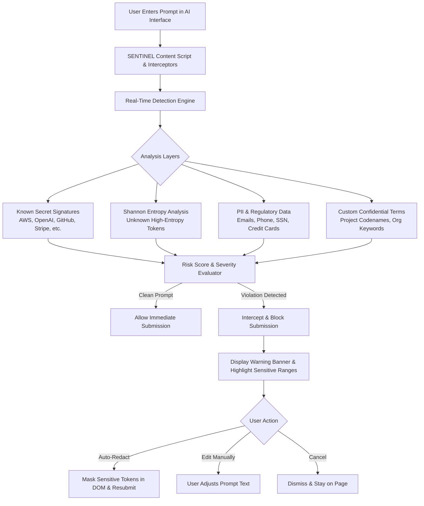

# 🛡️ Shadow AI Prompt Guardian — SENTINEL

[](https://developer.chrome.com/docs/extensions/mv3/intro/)
[](https://opensource.org/licenses/MIT)
[](https://doi.org/10.5281/zenodo.23205630)
[](#privacy--zero-trust-architecture)
[](#evaluation--benchmarks)

**SENTINEL** is a client-side Data Loss Prevention (DLP) and prompt security browser extension designed to protect sensitive credentials, API keys, Personally Identifiable Information (PII), and confidential trade secrets from being leaked into public and third-party AI models.

---

## ⚡ Key Highlights

- 🔒 **100% Client-Side Detection** — Zero telemetry, zero external network requests. All regex, entropy calculations, and risk evaluations run locally in your browser.
- 🚀 **Multi-Layer Defense Engine** — Combines format-specific regular expressions, Shannon entropy analysis, PII pattern matchers, and organizational keyword dictionaries.
- 🛑 **Deep Interception Pipeline** — Monitors form submissions, DOM enter-key triggers, send button interactions, and hooks both `window.fetch` and `XMLHttpRequest` in the capture phase.
- 🪄 **One-Click Auto-Redaction** — Sanitizes sensitive tokens in-place and safely formats prompts before submission without disrupting developer workflows.
- 📊 **Contextual Risk Scoring & Explainability** — Scores risk in real-time, displays categorized findings, and masks detected values in audit logs.
- 🌐 **Universal AI Platform Support** — Built-in support for ChatGPT, Claude, Google Gemini, Microsoft Copilot, Perplexity, Grok, Groq, Mistral, Poe, HuggingFace Chat, Cursor, and more.

---

## 🏗️ Architecture & How It Works



---

## 🎯 Supported AI Platforms

| Platform | Host Domain | Interception Modes |
| :--- | :--- | :--- |
| **OpenAI / ChatGPT** | `chatgpt.com`, `chat.openai.com` | DOM + Fetch / XHR Hook + Input Event |
| **Anthropic Claude** | `claude.ai`, `console.anthropic.com` | DOM + Fetch / XHR Hook + Input Event |
| **Google Gemini** | `gemini.google.com`, `google.com` | DOM + Fetch / XHR Hook + Input Event |
| **Microsoft Copilot** | `copilot.microsoft.com`, `bing.com` | DOM + Fetch / XHR Hook + Input Event |
| **Perplexity AI** | `perplexity.ai`, `www.perplexity.ai` | DOM + Fetch / XHR Hook + Input Event |
| **xAI Grok** | `grok.com`, `x.ai` | DOM + Fetch / XHR Hook + Input Event |
| **Mistral / Groq / Cohere** | `chat.mistral.ai`, `groq.com`, `cohere.ai` | DOM + Fetch / XHR Hook + Input Event |
| **Hugging Face / Poe** | `huggingface.co/chat`, `poe.com` | DOM + Fetch / XHR Hook + Input Event |

---

## 🔒 Privacy & Zero-Trust Architecture

- **No Remote Telemetry**: SENTINEL never sends prompt contents or detection metadata to any server.
- **Masked Local Storage**: Blocked attempt audit logs stored in `chrome.storage.local` store only masked previews (e.g., `AKIA••••••••••••••LE`), never raw secrets.
- **Pre-TLS Interception**: By analyzing and blocking inside the browser DOM before network packets leave the client, confidential data never touches external network streams.

---

## 📦 Installation & Setup

### Load Unpacked in Chromium Browsers (Chrome, Edge, Brave, Arc)

1. Clone or download this repository:
   ```bash
   git clone https://github.com/Roopesh05/shadow-ai-prompt-guardian.git
   cd shadow-ai-prompt-guardian
   ```
2. Open your browser and navigate to:
   - **Chrome**: `chrome://extensions`
   - **Edge**: `edge://extensions`
   - **Brave**: `brave://extensions`
3. Enable **Developer mode** (toggle in the top right).
4. Click **Load unpacked** and select the `shadow-ai-prompt-guardian` folder.
5. The **SENTINEL** shield icon will appear in your extension toolbar.

---

## 🧪 Testing & Evaluation

Run the automated evaluation harness and stress test suite:

```bash
# Run the 140-prompt primary evaluation harness (Table II & III)
node eval-harness.js

# Run the 1,000-prompt combinatorial adversarial stress test (Table IV & V)
node tests/stress-test.js

# Run the detection engine unit tests (121 tests)
node tests/test-detection-engine.js

# Run the senior QA checklist suite (137 checks)
node tests/qa-checklist.js
```

### Primary Evaluation Benchmark Results (140 Prompts — Table II & III)

| Metric | Score | Paper Reference |
| :--- | :--- | :--- |
| **Total Prompts Evaluated** | **140 Prompts** (5 Categories) | Section III-E |
| **Accuracy** | **100% (1.0000)** | Eq. (2) |
| **Precision** | **100% (1.0000)** | Eq. (3) |
| **Recall** | **100% (1.0000)** | Eq. (4) |
| **F1 Score** | **1.0000** | Eq. (5) |
| **False Positive Rate** | **0.0000** | Table II |
| **Confusion Matrix** | **TP: 95, TN: 45, FP: 0, FN: 0** | Table III |

### Large-Scale Combinatorial Stress-Test Results (1,000 Prompts — Table IV & V)

| Metric | Value |
| :--- | :--- |
| **Total Prompts** | 1,000 distinct combinatorial generations |
| **Correctly Blocked (TP)** | **954** |
| **Missed (FN)** | **46** |
| **Accuracy** | **95.4%** |
| **Failure Modes Identified** | 1. Label-style secret phrasing (28) · 2. Context-aware score suppression (18) |

---

## 📁 Repository Structure

```
shadow-ai-prompt-guardian/
├── manifest.json            # Manifest V3 configuration & permission mapping
├── popup.html / popup.js    # Interactive toolbar popup & quick toggles
├── options.html / options.js# Settings dashboard, custom rules & audit log
├── eval-harness.js          # Evaluation harness & metrics generator
├── results.json / results.md# Latest benchmark evaluation metrics
├── DECISIONS.md             # Architectural & engineering decision records
├── PROJECT_CHECKLIST.md     # Feature verification & implementation status
├── VERIFICATION_REPORT.md   # Security and functional testing reports
├── css/
│   └── content.css          # Warning banners, overlays, highlighting styles
├── js/
│   ├── background.js        # Service worker lifecycle & message passing
│   ├── content.js           # DOM observer, UI injector, input event interceptor
│   ├── detection-engine.js  # Core NLP, regex, entropy & scoring algorithms
│   ├── main-world-intercept.js # Network level fetch/XHR monkey-patching
│   └── phases/              # Phase-based modular extensions
├── icons/                   # High-res extension icons (16, 48, 128)
└── tests/
    ├── test-detection-engine.js # Unit test suite
    ├── test-prompts.json        # Test prompt corpus with labels
    └── qa-checklist.js          # Static & runtime verification suite
```

---

## ⚙️ Configuration Options

Open the **Extension Options** page to configure:
- **Sensitivity Threshold**: Adjust block threshold (Default: `30`).
- **Shannon Entropy Analysis**: Toggle entropy detection on unknown tokens.
- **Custom Confidential Keywords**: Add internal project codenames and domain keywords.
- **Audit Logs**: View, inspect, or clear locally masked detection logs.

---

## 📖 Citation

If you use **SENTINEL (Shadow AI Prompt Guardian)**, its benchmark datasets, or stress-test suites in your research or deployment, please cite the repository using the metadata provided in [`CITATION.cff`](CITATION.cff) or the BibTeX entry below:

```bibtex
@software{roopesh2026sentinel,
  author       = {Roopesh S N and Sreegokul S and Sanjeevkumar P and Saravana Kumar M and Ram Sakthi Sharumathi M},
  title        = {{Shadow AI Prompt Guardian — SENTINEL: A Zero-Trust Client-Side Data Loss Prevention (DLP) and Sensitive Data Interception System for Generative AI Platforms}},
  month        = oct,
  year         = 2026,
  publisher    = {Zenodo},
  version      = {v5.0.0},
  doi          = {10.5281/zenodo.23205630},
  url          = {https://github.com/Roopesh05/shadow-ai-prompt-guardian}
}
```

---

## 📄 License

This project is licensed under the [MIT License](LICENSE).
